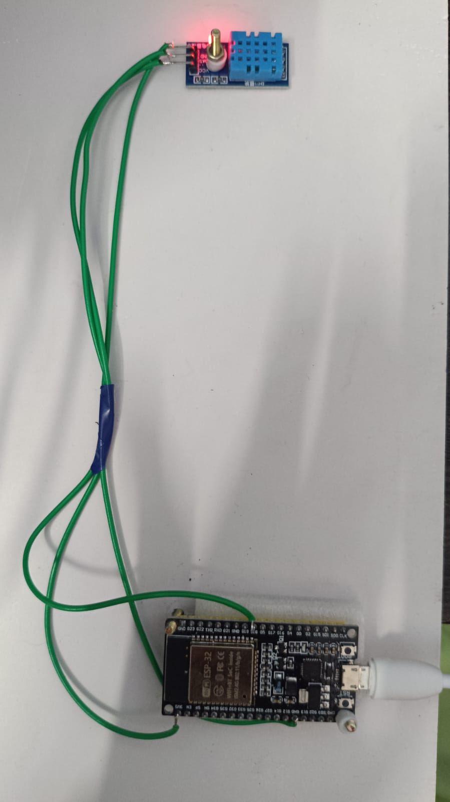
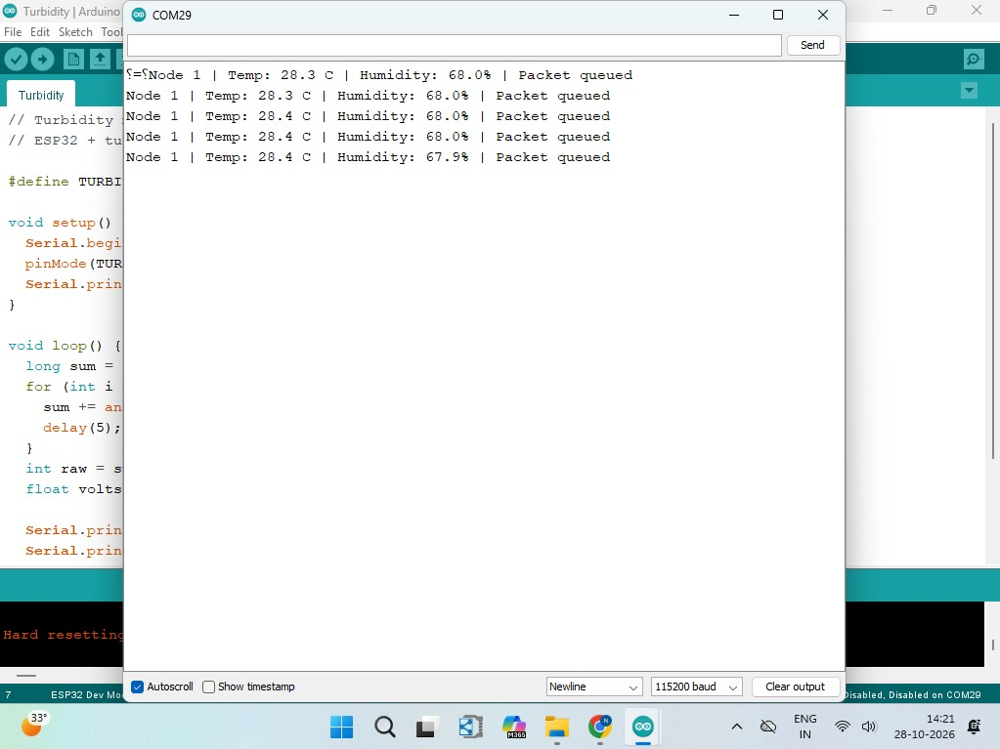
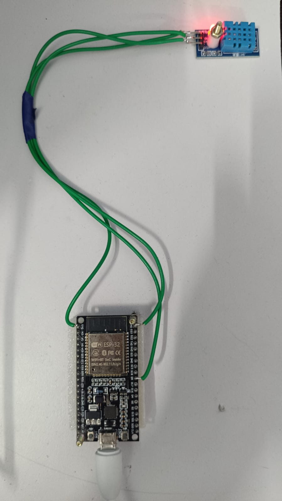
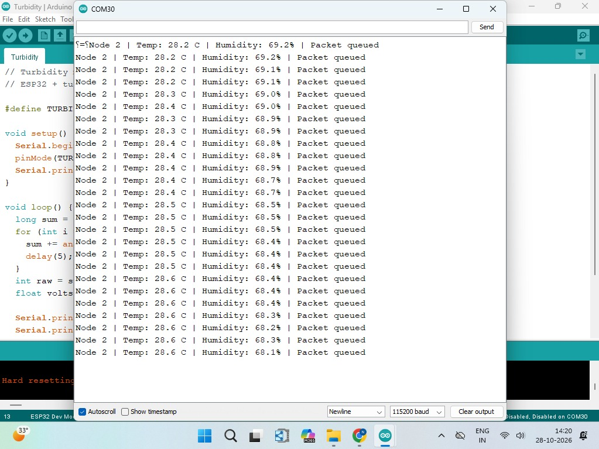
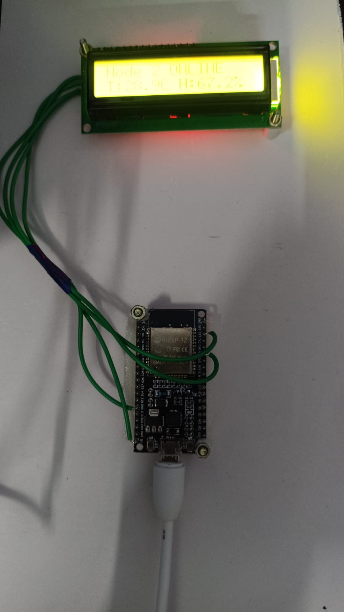

# ESP32 ESP-NOW Wireless Temperature and Humidity Monitoring System


## Project Overview

This project implements a wireless temperature and humidity monitoring system using three ESP32 development boards and two DHT11 sensors. The system uses **ESP-NOW communication** to transmit sensor readings from two transmitter nodes to a central receiver.

The receiver displays the temperature and humidity readings of Node 1 and Node 2 on a **16×2 I2C LCD**, switching between the two nodes every **3 seconds**.

## Key Features

- Wireless communication using ESP-NOW
- Two independent DHT11 transmitter nodes
- Centralized ESP32 receiver
- Real-time temperature and humidity monitoring
- Automatic LCD screen switching between nodes
- Node-specific online/offline status
- Sequence number included in each sensor packet
- Programming and power through USB

## Hardware Required

| Component                                | Quantity  |
| ---------------------------------------- | --------- |
| ESP32 development board                  | 3         |
| DHT11 temperature and humidity sensor    | 2         |
| 16×2 I2C LCD                             | 1         |
| Jumper wires                             | As needed |
| USB cable (data cable)                   | 3         |

## System Architecture

```
  Node 1 Transmitter                 Node 2 Transmitter
  ESP32 + DHT11                      ESP32 + DHT11
       |                                  |
       +---------- ESP-NOW ---------------+
                      |
                      v
              ESP32 Receiver
                      |
                      v
               16×2 I2C LCD
          Temperature & Humidity
```

## Pin Configuration

### Node 1 — Transmitter

| Signal         | ESP32 Pin |
| -------------- | --------- |
| DHT11 Data     | GPIO 18   |

### Node 2 — Transmitter

| Signal         | ESP32 Pin |
| -------------- | --------- |
| DHT11 Data     | GPIO 5    |

### Receiver — I2C LCD

| LCD Connection | ESP32 Pin |
| -------------- | --------- |
| SDA            | GPIO 21   |
| SCL            | GPIO 22   |
| I2C Address    | 0x27      |

## Code

The project has three Arduino sketches, one for each ESP32 board:

```
ESP32-ESP-NOW-DHT11-Wireless-Monitoring/
├── Node1_Transmitter/
│   └── Node1_Transmitter.ino
├── Node2_Transmitter/
│   └── Node2_Transmitter.ino
├── Receiver/
│   └── Receiver.ino
├── images/
│   ├── node1-setup.jpg
│   ├── node2-setup.jpg
│   ├── receiver-setup.jpg
│   ├── node1-serial-monitor.png
│   └── node2-serial-monitor.png
├── media/
│   └── project-demo.mp4
└── README.md
```

### Libraries Used

- Wi-Fi and ESP-NOW libraries
- DHT sensor library
- Wire library
- LiquidCrystal_I2C library

## How ESP-NOW Communication Is Enabled

ESP-NOW is a connectionless wireless protocol from Espressif. The ESP32 boards talk to each other directly, without a router or an internet connection. It is enabled in the code in these steps:

1. Include the `WiFi.h` and `esp_now.h` libraries.
2. Set the ESP32 to station mode using `WiFi.mode(WIFI_STA)`.
3. Start ESP-NOW using `esp_now_init()`. If it returns an error, ESP-NOW did not start.
4. On the **transmitters**, add the receiver as a peer using `esp_now_add_peer()`, then send each packet using `esp_now_send()`.
5. On the **receiver**, register a callback using `esp_now_register_recv_cb()`. It runs every time a packet arrives.

All three boards use **Wi-Fi channel 1**, so the transmitters and the receiver are on the same channel.

### Receiver MAC Address

ESP-NOW sends data to a specific device by its **MAC address**, so each transmitter must know the **MAC address of the receiver** before it can send anything. Without the correct MAC address, the data is not delivered.

To find and use it:

1. Connect the **receiver** ESP32 to the computer.
2. Set it to station mode with `WiFi.mode(WIFI_STA)` and print `WiFi.macAddress()` to the Serial Monitor.
3. Note the address, for example `AA:BB:CC:DD:EE:FF` (six values).
4. In both transmitter sketches (`Node1_Transmitter.ino` and `Node2_Transmitter.ino`), enter these six values as the receiver address.
5. Upload the sketches to the transmitters.

Both transmitters send to the same receiver, so both use the same MAC address. If you change the receiver board, find its MAC address again and update both transmitter sketches.

## Working

### Node 1 — Transmitter

Node 1 reads temperature and humidity from its DHT11 sensor (data pin GPIO 18). It puts the node ID, temperature, humidity and sequence number into a sensor packet and sends it to the receiver using ESP-NOW.



The Serial Monitor of Node 1 shows the temperature, humidity and packet queue status.



### Node 2 — Transmitter

Node 2 works independently from Node 1. It measures temperature and humidity with another DHT11 sensor (data pin GPIO 5) and sends its readings to the same receiver.



The Serial Monitor of Node 2 shows the temperature, humidity and packet queue status.



### Receiver — ESP32 with I2C LCD

The receiver collects the sensor packets from both transmitter nodes and shows their readings on the 16×2 I2C LCD (SDA GPIO 21, SCL GPIO 22, address 0x27). The display switches between Node 1 and Node 2 every 3 seconds.



### Overall Flow

1. Both ESP32 transmitter nodes read temperature and humidity from their respective DHT11 sensors.
2. Each transmitter creates a sensor packet containing the node ID, temperature, humidity, and sequence number.
3. The sensor packet is transmitted wirelessly using ESP-NOW on Wi-Fi channel 1 to the MAC address of the receiver.
4. The receiver identifies the source node using the node ID and updates the corresponding sensor values.
5. The 16×2 LCD displays the temperature and humidity readings for each node.
6. If a node's data has not been received for 8 seconds, the receiver displays its status as **OFFLINE**.

```
Read DHT11 → Send packet → Receiver updates node → LCD shows readings → repeat
```

## Output

The LCD on the receiver switches between Node 1 and Node 2 every 3 seconds and shows the temperature and humidity of each node. If a node stops sending for 8 seconds, its status changes to OFFLINE.

## How to Run

1. Open **Arduino IDE**.
2. Install the **ESP32 Arduino Core** and the DHT sensor and LiquidCrystal_I2C libraries.
3. Upload `Receiver.ino` to the receiver ESP32 and note its MAC address from the Serial Monitor.
4. Enter the receiver MAC address in `Node1_Transmitter.ino` and `Node2_Transmitter.ino`.
5. Upload `Node1_Transmitter.ino` to the first ESP32 and `Node2_Transmitter.ino` to the second ESP32.
6. Power all three boards with USB cables.
7. Watch the readings on the receiver LCD and the Serial Monitor.

## Important Notes

### Receiver MAC Address

The transmitters must use the correct MAC address of the receiver. If the readings do not arrive, check the address first.

### Wi-Fi Channel

ESP-NOW communication in this project uses **Wi-Fi channel 1**.

### LCD Address

The I2C LCD uses the address **0x27**. If the LCD stays blank, check the address of your module.

### USB Cable

Use a data-capable USB cable. Some cables only charge.

## Technologies and Concepts

- ESP32
- ESP-NOW
- MAC address based peer communication
- Arduino IDE
- Embedded C++
- DHT11 sensor interfacing
- I2C communication
- LCD interfacing
- Wireless sensor networks

## Future Improvements

- Add more sensor nodes
- Implement packet delivery confirmation
- Add data logging and remote monitoring
- Integrate additional environmental sensors

# 🎥 Project Video

[▶️ Watch the Project Demonstration](https://drive.google.com/file/d/12UJMg3z_9Kx2PWHZpSHpcdk65CP7yPd8/view?usp=drivesdk)
